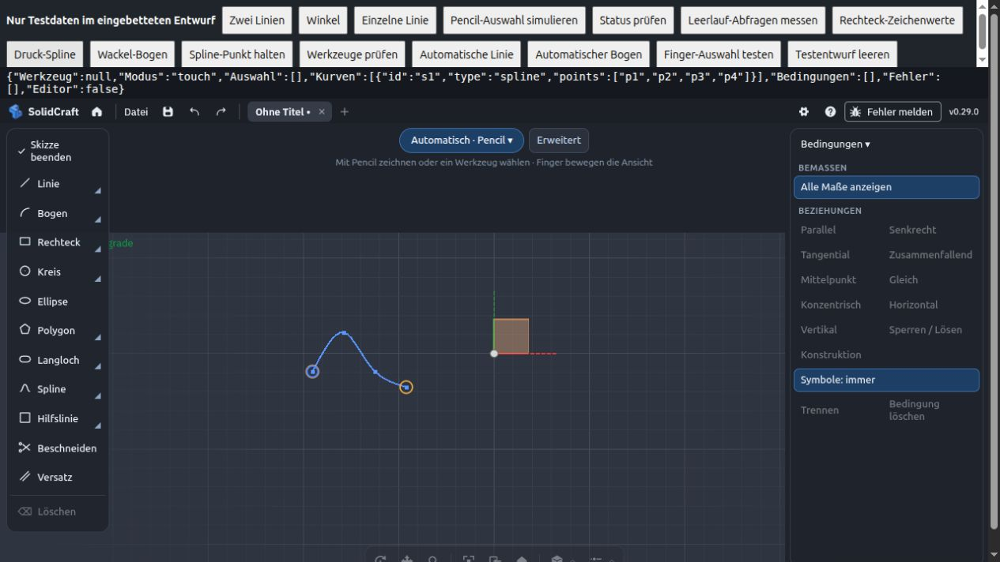

# iPad: flüssigere Eingabe und sichere Bedienung

Die Optimierungen ergänzen den Hauptstand 0.5.0 (`58e2189`). Das Gerätefeedback
zu kompakten Leisten, Werkzeugvarianten und Bemaßungsfehlern bleibt enthalten.
In der vorbereiteten 0.6.0 sind sie mit der Vollflächenansicht aus PR #8 kombiniert.
Die folgende Vergleichsmessung bezieht sich auf den zuvor separat geprüften Performance-Branch.

## Was sich ändert

- Eine gemeinsame Aktualisierung alle 350 ms versorgt Werkzeugstatus, Auswahl,
  Skizzensteuerung, Kontextaktionen und Zeichenfelder. Langsame Antworten erzeugen
  keinen Rückstau weiterer Timerdurchläufe. Bedienelement-Zonen werden ungefähr
  einmal pro Sekunde sowie nach relevanten Aktionen aktualisiert.
- Während Finger navigieren oder der Pencil zeichnet, pausiert diese regelmäßige
  Aktualisierung. Ausgeblendete Tabs fragen nicht weiter ab; beim Zurückkehren
  wird sofort aktualisiert. Direkte Prüfungen für Aktionen bleiben erhalten.
- Die Tintenvorschau bündelt Bewegungen pro Animationsframe. Bereits formatierte
  Koordinaten werden wiederverwendet; Druck- und Geometriesamples bleiben erhalten.
  Abheben zeigt den letzten Punkt sofort, Abbruch verwirft ausstehende Vorschauen.
- Etiketten werden gesammelt eingefügt, vermessen und platziert. Maße und
  Pencil-Treffflächen teilen sich Projektionsabfragen mit höchstens 1000 Punkten
  pro Anfrage, entsprechend der Grenze des eingebetteten Kerns.
- Auch bei ausgeblendeten Maßen folgen Pencil-Treffflächen der Kamera.
  Dokumentwechsel verwerfen alte Treffer und Etiketten; alte Etiketten können
  keinen gleich benannten Eintrag in einem anderen Dokument bearbeiten.
- Scrollen, Abbrechen oder das Abrutschen von einem Knopf der Bedingungen-Leiste
  führt keine Aktion aus. Finger bleiben von der Geometrieauswahl getrennt.
- Gleichzeitig ausgelöste Skizzenabfragen warten auf die aktuelle Auswahl.
  Änderungen der Dokumenteinheit werden in der geöffneten Skizze berücksichtigt.

Der vollständige Skizzenzustand wird weiterhin beim Kern abgefragt: Seine
Revisionsnummer allein erkennt einen Wechsel der aktiven Skizze nicht sicher.
Ein Cache nur anhand dieser Nummer würde falsche Geometrie anzeigen können.

## Nachweise und Wiederholung

`node --test tests/*.test.cjs` enthält nach Integration der Vollflächenansicht 82 Tests; zusätzlich bestehen die sechs
Python-Prüfungen für Herkunft, Offline-Inventar und Release-Pakete. Neue Fälle
prüfen gleichzeitige Abfragen, Dokument-/Einheitenwechsel, Kameraprojektionen,
große Skizzen, Scrollgesten und abgebrochene oder sehr kurze Pencil-Striche.

Ein deterministischer Eingabetest sendet 100 Bewegungen vor einem Animationsframe:
Die Vorschau schreibt einmal statt für jedes Ereignis den SVG-Punkttext; alle
101 Geometriesamples einschließlich des Anfangspunkts bleiben erhalten. Ein
weiterer Punkt formatiert nur seine neu hinzugekommenen Koordinaten.

Für die Browsermessung die unveränderte Basis und diesen Branch jeweils über
einen eigenen lokalen HTTP-Port öffnen. In `tests/sketch-browser.html` zuerst
„Zwei Linien“, danach „Leerlauf-Abfragen messen“ wählen und fünf Sekunden nicht
bedienen. Der Test zählt Aufrufe der öffentlichen CAD-API und stellt die ursprünglichen
Methoden anschließend wieder her. Das ist ein Vergleich der Hintergrundarbeit,
kein FPS-, Energieverbrauchs- oder Hardware-Benchmark.

Messung am 02.11.2026 im selben In-App-Desktop-Browser, jeweils mit der
Zwei-Linien-Testskizze, sichtbaren Maßen und ohne Bedienung während der Zählung:

| Öffentliche API-Aufrufe / 5 s | Hauptstand 0.5.0 | Optimierter Branch |
| --- | ---: | ---: |
| Insgesamt | 168 | 103 |
| `ui.inspect` | 43 | 14 |
| `ui.selection` | 25 | 14 |
| `sketch.inspect` | 19 | 14 |
| `ui.sketchToScreen` | 19 | 14 |

Das entspricht rund 39 % weniger Aufrufen in dieser Testskizze. Timerphasen und
Dokumentinhalt beeinflussen die Zahlen; die Messung verspricht keine entsprechende
Steigerung der Bildrate. Das Screenshot-Beispiel zeigt einen Druck-Spline nach
Übernahme durch das echte CAD-Modul. Zusätzlich wurde der direkte Winkelvorschlag
über das Ziffernfeld auf 45 deg gesetzt; der Kern meldet dazu `angle = π/4`,
gebunden an `d1`, ohne Fehler.

## Noch auf dem iPad prüfen

Browserprüfung mit echtem WASM im Desktop-Browser, keine physische iPad-Abnahme.
Für eine Geräteabnahme iPad-Modell, iPadOS-/Safari-Version und Pencil angeben:

1. Lange Linien-/Bogenstriche, Druck-Spline, Wackeln und schnelles Abheben testen.
2. Bedingungen-Leiste mit Finger scrollen; dabei dürfen keine Bedingungen entstehen.
3. Ansicht verschieben/zoomen, dann zwei Linien nacheinander mit Pencil auswählen.
4. Maß eingeben, abbrechen, Dokument wechseln und Einheiten ändern.
5. Safari in den Hintergrund legen und zurückkehren; Auswahl und Leisten müssen folgen.

Erst auf dem Gerät lassen sich die tatsächliche Eingabelatenz, Bildrate und
Energiewirkung beurteilen.
