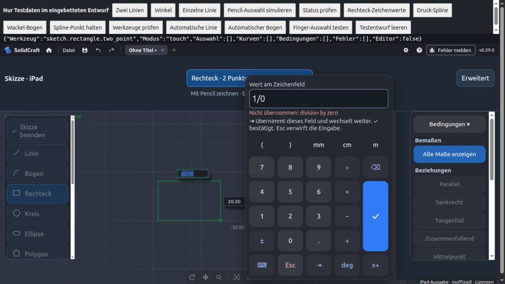
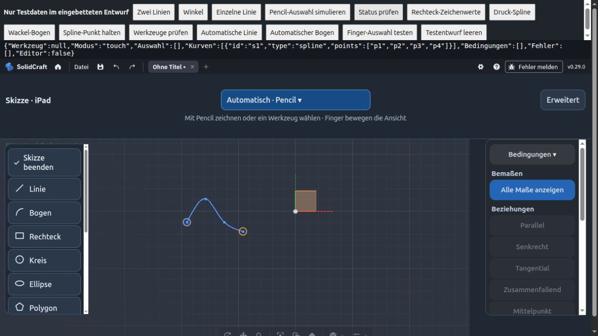

# AP 2 und AP 6 – Ergänzungen für 0.4.0

Diese Änderung ergänzt die noch offenen Punkte aus der Anforderungsliste vom
2. November 2026. Sie baut auf AP 7 in PR #5 auf und wird separat geprüft.
Der CAD-Kern und seine Lizenz-/Herkunftsnachweise bleiben unverändert.

## Zeichenwerte und Variablen (AP 2)

Ein Zahlenfeld beim Zeichnen antippen. Das Ziffernfeld zeigt einen lokalen
Eingabeentwurf. Die erste Zahl ersetzt den ursprünglichen Wert. ⇥ prüft den Ausdruck,
übernimmt ihn in das aktuelle native Feld und wechselt zum nächsten Feld, ohne die
Form schon zu platzieren. ✓ bestätigt die Form; Esc oder ein Tipp außerhalb verwirft
die noch nicht übernommene Eingabe. Bereits mit ⇥ bestätigte Vorschauwerte bleiben
Teil der nativen Zeichenabsicht. Die Systemtastatur wird nur mit ⌨︎ angefordert.

Alle Ausdrücke werden durch `expr.evaluate` und anschließend durch das native
Zeichenfeld ausgewertet; kein JavaScript-eval. Fehler bleiben im Ziffernfeld sichtbar.
Bei Rechteck, Kreis und Ellipse werden auch Längeneinheiten vor der Übergabe geprüft.
Ein Dokument-/Werkzeugwechsel verwirft den alten Entwurf. Die Schaltflächen enthalten
mm, cm, m, deg, Rechenzeichen und Klammern. Die Eingabe ist auf 256 Zeichen begrenzt.

Bei den ursprünglichen Vorschau-Feldern bietet die öffentliche API keinen Lesezugriff
auf ihren aktuellen Text. Dieser bleibt deshalb am Element sichtbar; das zusätzliche
Entwurfsfeld startet mit „Aktueller Wert steht am Element“. Beim Bearbeiten bereits
gebundener Maße zeigt der eigene Editor weiterhin den tatsächlichen Ausdruck an.
Eine vollständige Spiegelung aller nativen Vorschauwerte benötigt die Kern-API aus AP 8.

„x+“ öffnet vorhandene numerische Parameter. Antippen fügt den Namen in den Ausdruck
ein; der aktuell bearbeitete eigene Maßparameter wird nicht als Selbstreferenz angeboten.
„Wert als Variable vormerken“ macht beispielsweise `breite = 40 mm` daraus. Das
Anlegen erfolgt erst mit ✓ durch den Originalkern, gemeinsam mit der Bemaßung.
Bei einem bereits bestehenden Maß benennt der Kern dessen Parameter um. Namen dürfen
Buchstaben A–Z/a–z, Ziffern und _ enthalten; keine Leerzeichen, maximal 64 Zeichen,
keine bereits vergebenen Namen. Ein Abbruch legt keinen Parameter an.
Die Liste zeigt bis zu 200 numerische Parameter; die Kollisionsprüfung berücksichtigt alle.

Abnahme aus dem Dokument im echten WASM-Browser durchgeführt: Rechteck-Zeichenfeld
antippen → 30 → ⇥ → 16 → ✓ ergibt vier Linien mit gebundenen Längen 30 und 16 mm.
Ebenfalls geprüft: `breite = 40 mm` vormerken, bestätigen und den entstandenen
Parameter anschließend im Variablen-Menü wiederfinden.

## Pencil-Gesten (AP 6)

Ohne gewähltes Werkzeug unterscheidet die automatische Zeichnung weiterhin Linie
und Bogen. Mehrfaches kurzes Hin-und-her-Wackeln schaltet die gewünschte Art um;
„Bogen aktiviert“/„Linie aktiviert“ bestätigt den Wechsel. Die Wackel-Bewegung dient
als Umschalter und wird aus den Anpassungsdaten entfernt. Nach dem Umschalten auf
Bogen muss der weitere Strich genügend Krümmung für einen gültigen Bogen besitzen.
Eine Sperrzeit verhindert mehrfaches Umschalten durch dieselbe Wackelbewegung.
Ein passender Anschluss an die vorherige Linie verwendet einen tangentialen Bogen.

Spline-Werkzeug auswählen und mit dem Pencil ziehen. Ein deutlicher Druckanstieg
setzt einen Punkt; Abheben beendet die Form. „Durch Punkte“ erzeugt einen interpolierenden
Spline, „Kontrollpunkte“ übernimmt die Druckpunkte als Kontrollpunkte. Start und Ende
werden mitgeführt. Eine Hysterese und ein Mindestabstand vermeiden doppelte Punkte.
Wenn keine brauchbare Druckänderung geliefert wird, setzt kurzes Verweilen ebenfalls
einen Punkt. Native `Touch.force`-Werte werden verwendet; die Druckschwellen müssen
auf echter Hardware erprobt werden. Es wird keine native Pencil-Pro-/Squeeze-Anbindung behauptet.

Ohne aktives Werkzeug auf einem Spline durch Punkte lange halten und abheben:
Ein zusätzlicher Punkt wird an dieser Stelle eingefügt. Halten und danach ziehen
bleibt die Bereichsauswahl. Der Kern unterstützt das nachträgliche Einfügen bei
Kontrollpunkt-Splines noch nicht; dort erscheint ein Hinweis und die Geometrie bleibt
unverändert. Diese Kern-Erweiterung bleibt AP 8. Die API prüft Dokument und Skizze,
bevor Änderungen an einer verzögert erkannten Geste erfolgen.

Pro Strich maximal 4096 Rohpunkte und 128 Spline-Druckpunkte. Bei Überschreitung wird
kein abgeschnittener Teilstrich angelegt. Feedback bei Fehlern bleibt sichtbar.

## Validierung und offene Geräteabnahme

Automatisch: Eingabeentwürfe ohne vorzeitige Schreibzugriffe, Fehlerbehandlung,
Feldwechsel, Dokumentwechsel, doppelte Bestätigung, Variablennamen/Kollisionen,
Druckhysterese, Verweilen, Wackeln in beide Richtungen, tangentiale Konstruktion,
Hover-Zuordnung und Speichergrenzen. Die übrigen Regressionstests bleiben aktiv.

Im Chromium-In-App-Browser mit echtem SolidCraft-WASM geprüft:

- 30 × 16 mm Rechteck ausschließlich per Ziffernfeld und ⇥/✓.
- Variable `breite` anlegen und im Variablen-Menü auswählen.
- Druck-Spline mit Start, zwei Druckpunkten und Ende: vier native Spline-Punkte.
- Wackel-Strich erzeugt einen nativen Bogen.
- Langes Halten fügt zwischen zwei Spline-Punkten einen dritten Punkt ein.

Die Testseite `tests/sketch-browser.html` erzeugt nur isolierte Testentwürfe.
Auf echtem iPad stehen Druckschwellen, Wackel-Erkennung, Tastaturwechsel,
Feldfokus und Scrollen noch zur Abnahme aus. Diese Browser-Simulation ersetzt sie nicht.

Prüfstand: 46 Node-Tests und 6 Python-Pakettests bestanden. Im Browser wurde außerdem
`1/0` vor der Übergabe abgewiesen; ein anschließender Tipp außerhalb schloss den Entwurf
ohne Anlage eines Rechtecks. Original-WASM und Herkunft wurden erneut geprüft.

