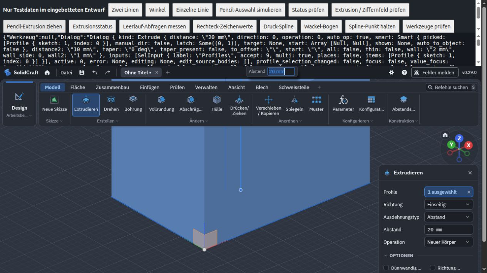
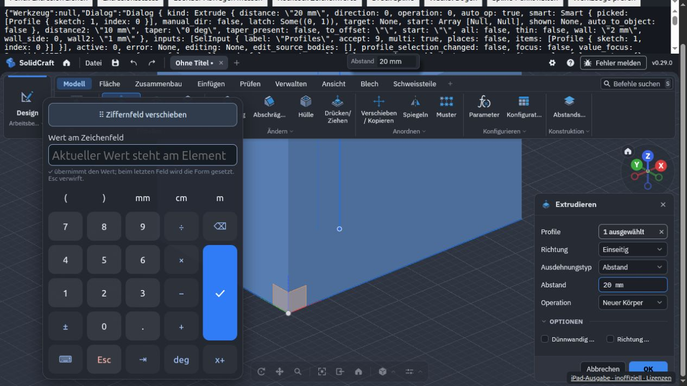

# Extrusion, bewegbares Ziffernfeld und Darstellung

## Ziffernfeld

Beim Start von Extrudieren setzt der Originalkern automatisch den Fokus auf den
Abstand. Dieser Fokus öffnet das Ziffernfeld jetzt nicht mehr. Ein kurzer Tipp mit
Finger, Pencil oder Maus auf das native Zahlenfeld öffnet den Eingabeentwurf.
Ein Zug am Extrusionsgriff und ein Tipp auf Auswahl-/Richtungs-/Operationsknöpfe
gelten nicht als Zahlenfeldeingabe. Die bewusste Tippabsicht wird nur einmal und
kurzzeitig verwendet; nach Abbrechen öffnet Autofokus den Entwurf nicht erneut.

Oben steht ein Griff „Ziffernfeld verschieben“. Dort anfassen und ziehen; die
Zifferntasten bleiben normale Eingabeknöpfe. Die eigene Position bleibt während
der Sitzung auch beim erneuten Öffnen erhalten. Nach Fenster-/Tastaturgrößenwechsel
wird sie auf den sichtbaren Bereich begrenzt. Mit fokussiertem Griff bewegen
Pfeiltasten das Fenster um 10 Pixel, Umschalt+Pfeil um 50 Pixel. Abgebrochene
Zeigergesten stellen die vorherige Position wieder her.

Beim ersten Öffnen wird eine Position mit möglichst wenig Überschneidung mit dem
nativen Dialog gesucht. Bei sehr wenig Platz bleibt manuelles Verschieben möglich.
Der Eingabeentwurf verändert den nativen Wert weiterhin erst nach Bestätigung.

## Flüssiger ziehen

Für Pencil-Züge an einem Dialoggriff wird die letzte Bewegung eines Ereignisblocks
vor dem nächsten Animationsframe an den nativen Eingang zugestellt. Der bisherige
zusätzliche RAF-Warteframe entfällt. Beim Loslassen bleibt die genaue Endposition
erhalten. Die native Darstellung rendert weiterhin in ihrem eigenen Frame.

Während nativer Mauszüge pausieren die regelmäßigen Zustandsabfragen, einschließlich
Feldprüfung. Dialog- und Modellzüge starten keine unnötige Skizzen-Vorabfrage.
Auflösung, Vorschau und Geometriegenauigkeit werden dafür nicht reduziert. Die
Kosten für B-Rep-Berechnung und Vorschau im ursprünglichen WASM-Kern bleiben eine
Grenze; eine bestimmte iPad-Bildrate wird nicht behauptet.

## Helle Statusleiste und Unschärfe

Der Bereich mit Uhr/VPN/Akku gehört zu iPadOS bzw. Safari. Die Seite hatte einen
hellen Hintergrund und eine durchscheinende Statusleisten-Vorgabe. Eigene Seiten-,
Start- und Themenfarben sind jetzt einheitlich dunkel; für die installierte Web-App
wird `apple-mobile-web-app-status-bar-style=black` statt `black-translucent`
angefordert. Die tatsächliche Systemleiste bleibt vom Betriebssystem abhängig.
Siehe [Apple: Web-App-Konfiguration](https://developer.apple.com/library/archive/documentation/AppleApplications/Reference/SafariWebContent/ConfiguringWebApplications/ConfiguringWebApplications.html)
und [WebKit: theme-color](https://webkit.org/blog/11989/new-webkit-features-in-safari-15/).

Dauerhafte Unschärfe auf dem gemeldeten iPad konnte im Desktop-Test nicht
reproduziert werden. Es wird deshalb keine bestätigte Behebung der gesamten
Darstellungsunschärfe behauptet. Der Adapter skaliert den Canvas nicht per CSS-
Transformation hoch und erzwingt keine reduzierte Renderauflösung.

Nach Übernahme der Änderung zeigt `?touchdebug=1` in der lokalen Diagnose:

- Canvas-Pixelgröße und CSS-Anzeigegröße;
- `devicePixelRatio` und ob die Auflösung dazu passt;
- Seitenzoom (`visualViewport.scale`).

Die Werte werden lokal aus dem DOM gelesen; es entsteht kein zusätzlicher
CAD-Polling-Timer und kein automatischer Upload. Für die Geräteabnahme diese Werte
sowie iPad-Modell, iPadOS-Version und Safari/Home-Bildschirm-Modus festhalten. Eine
abweichende Auflösung ist ein konkreter Hinweis auf Streckung; passende Werte
schließen andere Ursachen wie System-Compositing oder browserseitige Darstellung
nicht aus. Bestehende Offline-Tabs müssen die neue Ausgabe erst laden.

## Prüfung

92 Node-Tests und sechs Python-Prüfungen. Neue Fälle decken Tippabsicht, Autofokus,
einmaliges Öffnen, abgebrochene Eingaben, Griffbewegung, Pointer-Capture, Größenwechsel,
Dialogvermeidung, Ereignis-Bündelung ohne RAF-Warteframe und Retina-Diagnose ab.

Chromium-In-App-Browser mit echtem WASM, nur isolierte Testgeometrie:

- Extrudieren startet mit Abstand 10 mm; trotz `value_focus` bleibt das Numpad zu.
- Simulierter Pencil-Zug am Griff verändert den Abstand auf 20 mm, Numpad bleibt zu.
- Klick auf „Abstand“ öffnet das Numpad; Ziehen am Griff versetzt es nach links.
- Nach dem Verschieben lässt sich `25 mm` eingeben und bestätigen.
- Canvas 1265 × 620 Pixel bei 1265 × 620 CSS-Pixeln und DPR 1: passende Auflösung.
- Keine physische iPad-/Safari-Abnahme und keine Hardware-Latenz-/FPS-Messung.

