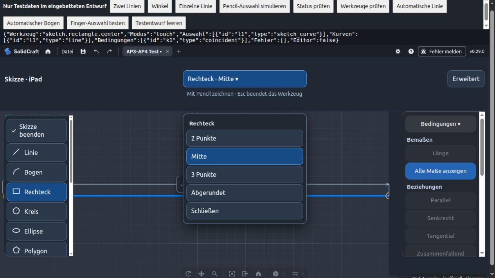
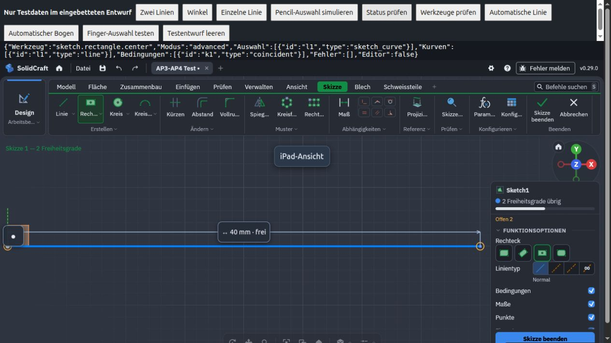
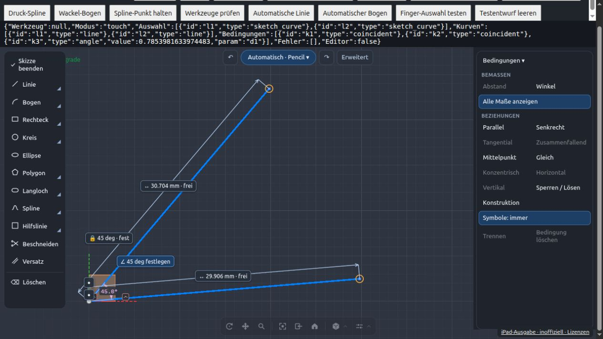

# AP 7 – iPad-Skizzenansicht

Vorbereitet für 0.4.0, Zeichenfläche ohne Kopfband seit 0.6.0. Der unveränderte SolidCraft-Kern bleibt Version 0.29.0.
Diese Änderung behandelt AP 7 aus der bereitgestellten Anforderungsliste vom
2. November 2026. Restpunkte aus AP 2/6 und der eigene Rust-Build (AP 8) sind getrennt.

## Bedienung

In einer aktiven Skizze erscheint standardmäßig die iPad-Ansicht. Links steht jede
Werkzeugfamilie einmal: Linie, Bogen, Rechteck, Kreis, Ellipse, Polygon, Langloch,
Spline, Hilfslinie, Beschneiden und Versatz. Rechts bleiben Maße und Bedingungen.
Mit dem Pencil lässt sich weiterhin ohne Werkzeugwahl automatisch zeichnen.

Unter „Skizze beenden“ steht „Extrudieren“. Ist ein Profil gewählt, wird es übernommen;
sonst wird es danach angetippt. Die Skizze wird dabei automatisch beendet.

Ein linker Werkzeugknopf startet die zuletzt gewählte Variante dieser Familie und klappt bei
Werkzeugen mit Varianten (kleines Dreieck) die Variantenwahl direkt daneben auf.
Die blaue Pille oben zeigt das aktive Werkzeug mit Variante. Antippen öffnet die
Variantenwahl; beispielsweise Rechteck → Mitte / 2 Punkte / 3 Punkte / Abgerundet.
Ohne aktives Werkzeug öffnet die Pille die gesamte Werkzeugauswahl. Ein Variantenwechsel
verwendet die native Werkzeugumschaltung: noch nicht abgeschlossene Vorschauen können
verworfen werden; bereits erzeugte Geometrie bleibt erhalten.

„Erweitert“ zeigt die ursprüngliche SolidCraft-Befehlsleiste und Skizzenpalette.
Die eigene linke Werkzeugleiste und rechte Bedingungen-Leiste verschwinden dabei.
„iPad-Ansicht“ schaltet zurück. Freie und gebundene Maßetiketten bleiben verwendbar.
Modus und Varianten werden lokal auf diesem Gerät gespeichert; sie ändern keine
Datei und erzeugen keine Undo-Schritte. Der beim Eintritt vorhandene Browser-Zustand
wird beim Austritt wiederhergestellt. Native Dialoge zeigen vorübergehend die
Originaloberfläche; danach kehrt die gewählte Ansicht zurück.

Finger können UI-Knöpfe bedienen und die Listen scrollen. Szenengeometrie und ihre
Symbole werden weiterhin ausschließlich mit dem Pencil ausgewählt. Scrollen über
einem Werkzeugknopf startet kein Werkzeug. Esc schließt zunächst eine offene
Variantenwahl; „Werkzeug beenden“ bedient die native Escape-Logik.

## Layout und technische Grenze

Seit 0.5.0 sind die eigenen Knöpfe kompakt (mindestens 32 CSS-Pixel, Etiketten an der
Geometrie 22 bis 24 Pixel), weil der Pencil präzise trifft und die 44-Pixel-Variante im
Gerätetest zu viel Platz belegte. Die Listen scrollen weiterhin, statt Knöpfe weiter zu verkleinern.
Split View erscheinen die linken Werkzeuge als Symbole mit zugänglichen Namen.
Maß-/Bedingungssymbole vermeiden die eigenen Leisten. Die Maße-/Bedingungen-Aktionen
werden nicht zusätzlich in der linken Leiste oder einer Kontextleiste angeboten.
Rückgängig/Wiederholen stehen seit 0.6.0 als kleine Knöpfe neben der Werkzeug-Pille und bleiben per Geste verfügbar.

Der übernommene CAD-Kern zeichnet Befehlsleiste und Skizzenpalette in ein einziges
Canvas. Er bietet keine öffentliche API zum echten Ein-/Ausklappen dieser Bereiche.
Seit 0.6.0 verschiebt `canvas-shift.js` das Canvas im iPad-Modus um die gemessene Unterkante
der Befehlsleiste (rund 160 Pixel) nach oben und vergrößert es um denselben Betrag. Kopfzeile
und Befehlsleiste liegen damit außerhalb des Bildschirms; der Platz steht dem Modell zur
Verfügung. SolidCraft rechnet Berührungen über die Lage des Canvas selbst um. Die Datei hüllt
zusätzlich `window.solidcraft` ein und rechnet Bildschirmkoordinaten in Antworten (`ui.handles`,
`ui.inspect`, `ui.sketchToScreen`, `ui.worldToScreen`, `ui.at`, `ui.selection`) und Anfragen
(`ui.pick`, `view.pick`, `ui.click`, `ui.move`, `ui.drag`, `ui.scroll`, `ui.menu`) um.
Die übrigen Skripte arbeiten daher unverändert mit Bildschirmkoordinaten. Im erweiterten Modus,
außerhalb von Skizzen und mit `?fullsketch=off` bleibt das Canvas unverändert.
Die Größe der ursprünglichen Dialog- und Menüknöpfe benötigt weiterhin AP 8.

## Prüfung

Node-Tests prüfen gespeicherte Werte, erlaubte Varianten, sichere Standardwerte,
Moduswechsel ohne Geometriebefehl, Wiederherstellung des Browsers, Dialog-/Home-Wechsel,
veraltete Werkzeugtipps und gezielte Auswahl vor dem Löschen. Die vorhandenen Tests
für Bemaßung, Finger/Pencil und automatisches Zeichnen bleiben Bestandteil der CI.

Die lokale Testseite `tests/sketch-browser.html` erzeugt ausschließlich Testentwürfe
in einer eingebetteten Instanz. „Status prüfen“ zeigt Werkzeug, Modus, Auswahl und
Bedingungen aus dem echten CAD-Kern. Nicht für eigene Designs verwenden.

Noch auf echtem Gerät abzunehmen: Werkzeug mit Pencil starten, Rechteckvarianten
wechseln, links und in der Variantenwahl mit Finger scrollen, zweimal zwischen iPad
und Erweitert wechseln, Skizze beenden und erneut öffnen, danach App neu laden.
Geometrie und Bemaßungen müssen erhalten bleiben. iPad-Modell/iPadOS/Safari-Version
mit dem Ergebnis dokumentieren. Browser-Simulation ersetzt diese Abnahme nicht.

## Browser-Prüfstand dieser Änderung

Geprüft im Chromium-In-App-Browser mit dem echten SolidCraft-0.29.0-WASM:

- Alle 38 angebotenen Varianten im nativen Befehlskatalog vorhanden.
- Rechteck starten, auf „Mitte“ wechseln, Werkzeugname und Geometrie im Kern prüfen.
- Erweitert/iPad umschalten: aktives Werkzeug und bereits vorhandene Linie bleiben erhalten.
- Nach Neuladen bleiben Modus und gewählte Rechteckvariante gespeichert.
- 768 × 1024 und 512 × 768 CSS-Pixel: keine neuen Knöpfe unter 32 × 32 CSS-Pixel (Etiketten an der Geometrie 22 bis 24);
  linke Leiste bis zum Ende scrollbar, kein seitlicher Überlauf.
- Direkte Maßbearbeitung über dem neuen Layout: Ziffernfeld öffnen und 30 mm binden;
  der native Parameter d1 besitzt danach den Wert 30 mm. Das Ziffernfeld liegt vor den
  Leisten und ist bei geringer Höhe scrollbar.
- 29 Node-Tests und 6 Python-Pakettests erfolgreich. Unverändertes WASM und
  Herkunftsinventar erneut gegen das offizielle Release-Archiv geprüft.

Die Prüfbilder zeigen ausschließlich erzeugte Testdaten, keine eigenen Designs:

## Gemeinsame Abnahme von PR #8 und #9

Der Branch enthält den Hauptstand nach PR #9 und bereitet weiterhin Version 0.6.0
vor. Gebündelte Zustandsabfragen, Tintenvorschau, gesammelte Etikettenplatzierung,
aktuelle Pencil-Treffflächen und der Scrollschutz bleiben enthalten.

82 Node-Tests einschließlich acht ergänzter Integrations-/Koordinatenfälle sowie
sechs Python-Tests prüfen den gemeinsamen Stand. Die Koordinatentests decken
CSS-Pixel, physische Pick-Pixel bei Pixelverhältnis 1/2/3, viewport-lokale Picks,
Moduswechsel, Opt-out und eine nach Größenwechsel neu gemessene Befehlsleiste ab.
Im ausgeblendeten Tab werden keine Messabfragen gestartet. Ein während einer
Messung verlassener iPad-Modus aktiviert keine veraltete Verschiebung.

Die native Zeichnung und API-Treffzonen werden nach einem Canvas-Umbau neu
abgeglichen. Freie Maße bleiben auf die Auswahl bzw. zuletzt erzeugte Geometrie
begrenzt; doppelte parallele Seiten werden unterdrückt. Die gemeinsame Projektion
berücksichtigt den Formmittelpunkt und die native Grenze von 1000 Punkten.

Im gemeinsamen Chromium-/WASM-Test wurde der Winkelvorschlag geöffnet und über
das Ziffernfeld auf 45 deg gebunden (`d1`, im Kern π/4). Erweitert entfernte die
Canvas-Verschiebung, iPad-Ansicht aktivierte sie wieder; das Maß blieb erhalten.
Das ist eine Desktop-Browserprüfung, keine physische iPad-Abnahme.

